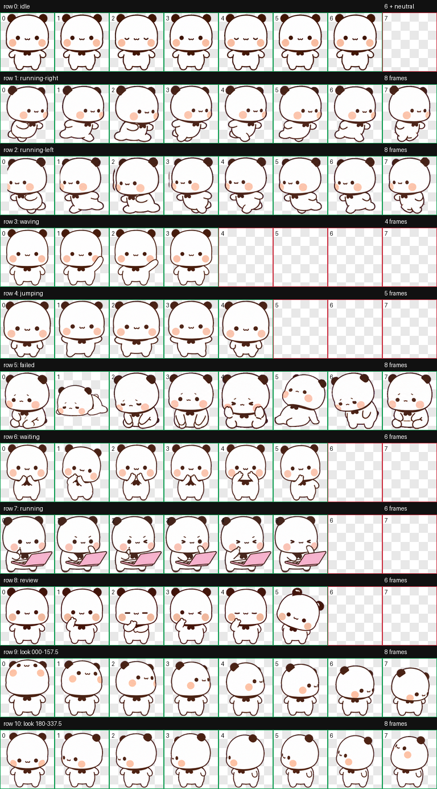
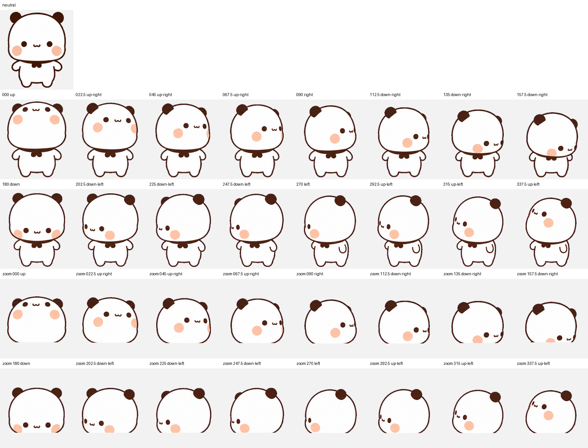

# 一二 · Yi Er

一只陪你工作的小白熊。 / A little white bear to keep you company while you work.

[中文](#中文) · [English](#english) · [下载 / Download](https://github.com/kjw0716/yi-er-bao/archive/refs/heads/main.zip)

<p align="center">
  
  
  
</p>

## 中文

### 关于一二

一二是由 [kjw0716](https://github.com/kjw0716) 设计的宠物角色：圆圆的白色身体、深棕色的耳朵和轮廓、粉色腮红，还有温柔的小表情。

这个仓库收录了一二的最终动画素材、Codex 本地宠物配置和预览图。素材采用透明背景，包含 9 组动作、16 个视线方向，以及一个正面中立视线帧。

### 动画预览

| 待机 | 向右跑 | 向左跑 |
| --- | --- | --- |
|  |  |  |

| 挥手 | 跳跃 | 失落 |
| --- | --- | --- |
|  |  |  |

| 等待 | 工作 | 思考 |
| --- | --- | --- |
|  |  |  |

### 下载与使用

点击上方的「下载」，或使用 GitHub 的 **Code → Download ZIP**。解压后，可以直接打开 `previews/` 中的 GIF 查看动作。

本仓库采用作者本机使用的 Codex 本地 v2 宠物文件结构，精灵图保持原样，配置中的显示名称为「一二」。对于支持这一套本地 v2 宠物格式的 Codex 客户端，可将这两个文件一起放到：

```text
~/.codex/pets/yi-er-bao/
├── pet.json
└── spritesheet.webp
```

如果设置了 `CODEX_HOME`，则使用 `$CODEX_HOME/pets/yi-er-bao/`。保留 `spriteVersionNumber: 2`，并确保 `spritesheetPath` 指向同目录下的 `spritesheet.webp`。已有同名宠物时，请先备份再替换。

这个安装布局来自作者本机配置；其他客户端版本的加载、选择和刷新方式可能不同。仓库提供动画素材和配置，不包含独立桌面程序。

### 文件说明

| 文件 | 用途 |
| --- | --- |
| `pet.json` | 一二的名称、描述和 v2 宠物配置 |
| `spritesheet.webp` | 安装使用的完整透明精灵图 |
| `spritesheet.png` | 同一完整精灵图的 PNG 版本 |
| `layout.json` | 精灵图尺寸、中立视线帧和 16 个方向的坐标 |
| `previews/` | 9 个 GIF 动画、动作总览和视线方向总览 |

### 精灵图规格

- 完整尺寸：**1536 × 2288 px**，8 列 × 11 行。
- 单格尺寸：**192 × 208 px**，RGBA 透明背景。
- 行列索引从 0 开始；具体动作帧数见下方共享布局表。
- 第 0 行第 6 列是中立视线帧，不参与 6 帧待机循环。
- 第 9、10 行存放 16 个视线方向，每次递增 22.5°。0° 向上、90° 向屏幕右侧、180° 向下、270° 向屏幕左侧。
- GIF 用于预览，其播放节奏不代表所有客户端的实际播放节奏。

### 作者与使用许可

角色设计：[kjw0716](https://github.com/kjw0716)。本仓库用于公开展示和分享项目文件，尚未附带开放使用许可；如需再分发、改作或商业使用，请先联系作者。

## English

### Meet Yi Er

Yi Er (一二) is a pet character designed by [kjw0716](https://github.com/kjw0716): a round white bear with dark brown ears and outlines, pink cheeks, and a gentle expression.

This repository contains the finished animation assets, a local Codex pet configuration, and previews. The transparent spritesheet includes nine animation states, sixteen look directions, and a neutral front-facing look frame. See the animated gallery above.

### Download and use

Use the **Download** link at the top or GitHub's **Code → Download ZIP**. After extracting the archive, open the GIFs in `previews/` to view the animations.

This package follows the author's local Codex v2 pet file structure. The spritesheet is unchanged, and the configured display name is 一二 (Yi Er). For a Codex client that supports this local v2 pet format, place both files in:

```text
~/.codex/pets/yi-er-bao/
├── pet.json
└── spritesheet.webp
```

If `CODEX_HOME` is set, use `$CODEX_HOME/pets/yi-er-bao/` instead. Keep `spriteVersionNumber: 2` and make sure `spritesheetPath` points to `spritesheet.webp` in the same directory. Back up any existing pet with the same ID before replacing it.

This installation layout reflects the author's local configuration. Loading, selection, and refresh behavior may differ between client versions. This repository supplies assets and configuration; it does not include a standalone desktop application.

### Files

| File | Purpose |
| --- | --- |
| `pet.json` | Pet name, description, and v2 configuration |
| `spritesheet.webp` | Complete transparent spritesheet used for installation |
| `spritesheet.png` | PNG version of the same complete spritesheet |
| `layout.json` | Sheet dimensions, neutral look frame, and coordinates for all sixteen look directions |
| `previews/` | Nine animation GIFs, an animation contact sheet, and a look-direction overview |

### Spritesheet specifications

- Full sheet: **1536 × 2288 px**, arranged in 8 columns and 11 rows.
- Cell size: **192 × 208 px**, with RGBA transparency.
- Row and column indices start at zero. Animation frame counts are listed below.
- Row 0, column 6 contains the neutral look frame, separate from the six-frame idle loop.
- Rows 9 and 10 hold sixteen look directions at 22.5° intervals: 0° up, 90° screen-right, 180° down, and 270° screen-left.
- GIFs are previews; their timing may differ from playback in a client.

### Creator and permissions

Character design by [kjw0716](https://github.com/kjw0716). This repository presents the project and its files publicly. No open-use license is included. Please contact the creator before redistributing, adapting, or using the assets commercially.

## 布局 / Layout

| 行 / Row | 状态 / State | 帧数 / Frames |
| --- | --- | --- |
| 0 | `idle` · 待机 / Idle | 6 + 1 neutral look frame |
| 1 | `running-right` · 向右跑 / Run right | 8 |
| 2 | `running-left` · 向左跑 / Run left | 8 |
| 3 | `waving` · 挥手 / Wave | 4 |
| 4 | `jumping` · 跳跃 / Jump | 5 |
| 5 | `failed` · 失落 / Disappointed | 8 |
| 6 | `waiting` · 等待 / Wait | 6 |
| 7 | `running` · 工作 / Work | 6 |
| 8 | `review` · 思考 / Think | 6 |
| 9 | `look` · 0° to 157.5° | 8 |
| 10 | `look` · 180° to 337.5° | 8 |

<details>
<summary>全部动作与视线帧 / All animation and look frames</summary>



</details>

<details>
<summary>16 个视线方向 / Sixteen look directions</summary>



</details>
